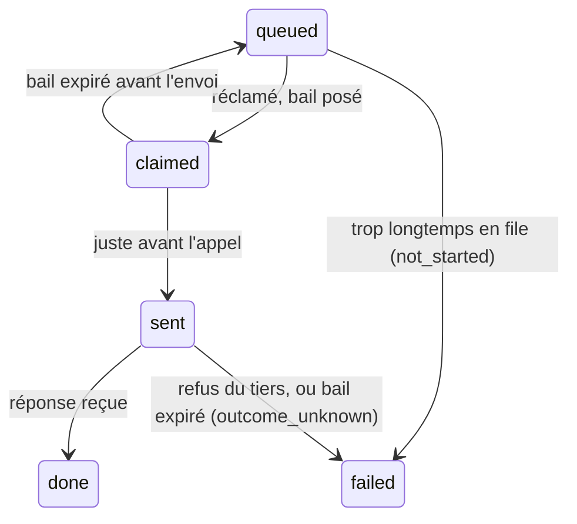

# Fonctions longues

- **Statut** : validé avec Alexis le 22/10/2026
- **Dernière révision** : 2026-10-22

## Résumé

Une fonction de connecteur déclarée longue (`background: true`) ne s'exécute pas pendant que l'assistant attend : le
moteur la met en file et rend aussitôt un identifiant de travail, qu'il relève par la fonction native `job.read`. Le
moteur tient la file en base et l'exécute (`runJobs`) ; l'hôte ne fournit que le déclencheur. Un appel parti n'est
jamais relancé tout seul, et son coût ne se règle qu'une fois.

## Contexte

- Un connecteur ne fait jamais attendre l'assistant. Certains tiers répondent pourtant en minutes à un appel unique,
  synchrone. Exemple directeur : une transcription audio (Voxtral) prend de 20 s à 5 min pour 30 min d'audio.
- Le format sait déjà dire un travail **tenu par le tiers** (`async` : une soumission courte, puis une relève
  `collect` qui rappelle le tiers ; `connecteurs-et-comptes.md` § Coût d'un appel). Il ne sait pas dire un appel long
  dont c'est l'hôte qui doit tenir l'attente.
- `timeout_s` est un plafond, pas une durée attendue : 24 des 35 connecteurs décrits déclarent 60 s ou plus pour
  toutes leurs fonctions, qui répondent en une seconde.
- Le moteur n'a aucune file, aucune tâche planifiée ni aucun worker. L'hôte lui fournit déjà `defer` (une tâche après
  la réponse, `after` de Next), bornée par la durée de la route. La base coupe une requête et une transaction inactive
  à 8 s, avec un pool de 5 connexions (`base-et-portabilite.md`).
- L'outil précédent tenait une file propre à la transcription : une table de travaux, un worker à trois voies, une
  relève dédiée, une seule tentative par appel payant, et la clôture des travaux orphelins. Ce document en reprend les
  leçons pour toute fonction décrite.

## Objectifs et non-objectifs

- Objectifs : aucune attente de l'assistant au-delà d'une mise en file ; le résultat d'une fonction longue est
  exactement celui de l'appel synchrone (données, fichier en transit, refus), seul le moment change ; aucun appel payé
  deux fois ; un moteur neutre, sans fournisseur d'exécution.
- Non-objectifs : remplacer `async` (le tiers qui tient le travail garde sa relève décrite) ; relancer un appel après
  son envoi ; la réservation et le plafond de coût (chantier du coût, « Écart avec le code ») ; une fonction longue
  paginée.

## Conception

### Ce que voit l'assistant

1. `call {"function": "mistral.transcribe", "arguments": {"file": "<id>"}}` rend tout de suite
   `{job: "<id>", status: "queued", retry_after_s}`, avec une phrase qui dit comment relever.
2. `call {"function": "job.read", "arguments": {"job": "<id>"}}` : `queued` ou `running` avec `retry_after_s` ; puis
   `done` avec la réponse qu'aurait rendue l'appel synchrone (ici `{file, url: "/f/<id>", expires_at}`), ou `failed`
   avec son refus, même code et même message.

`job.read` est une fonction native de `call`, comme `file.keep` (les six outils restent figés). Elle ne rappelle
aucun tiers. Un travail n'est lisible que par son auteur, comme un fichier en transit ; son résultat dure 24 h, comme
le fichier qu'il rend, puis `job.read` dit quand et pourquoi il a été effacé. Relancer la même fonction avec les mêmes
arguments pendant qu'un travail identique court rend ce travail-là, sans en créer un second.

### Le format

Un mot, `background: true`, sur la fonction : un fait du tiers (la réponse vient en minutes). Il exige un `timeout_s`
propre à la fonction (1 à 300 s), le délai de l'appel lui-même, file non comprise. La fabrique le refuse avec `async`,
sur une fonction de relève et sur une fonction paginée. La règle 17 admet `output.file` sur une fonction `background`
(le fichier vient du même appel) ; elle le refuse toujours sur `async` et sa relève. Le moteur ajoute à la description
servie une phrase fixe sur l'identifiant de travail ; aucune description ne la réécrit. Le client Python ignore le mot
et appelle en synchrone : son consommateur choisit où l'appel tourne. Règle de référence : `connectors :
docs/conception/format-de-description.md`.

### Le moteur

- **Mise en file** : `runCall` fait les mêmes contrôles qu'un appel synchrone (fonction active, arguments, compte,
  récapitulatif d'une fonction sensible), vérifie qu'un fichier d'entrée existe et appartient à l'auteur, puis écrit
  le travail au lieu d'appeler le tiers, et pousse l'exécution par `defer(() => runJobs({ limit: 1 }))`.
- **La table des travaux** : auteur, organisation, équipe, fonction, compte, arguments, état, bail, résultat,
  échéance ; sous la RLS, lisible par son seul auteur.
- **L'exécutant**, `runJobs({ limit })` : réclame sans doublon (`FOR UPDATE SKIP LOCKED`) et mène chaque travail à sa
  fin en trois transactions courtes (réclamer ; marquer « envoyé » ; conclure). L'appel HTTP se fait entre les deux
  dernières, hors transaction. Il reconstruit l'identité de l'auteur depuis la ligne
  (`createPlatformDb({ caller: { userId } })`, comme le dépôt par lien) : secret résolu à l'exécution
  (`liveCredential`), fichier d'entrée relu et fichier rendu rangé en transit sous les droits de l'auteur, sans rôle de
  service. Le secret n'est jamais recopié sur le travail.

### Les états et les pannes

- **Redémarrage** : un travail `claimed` dont le bail a expiré revient en file, rien n'est parti. Un travail `sent`
  dont le bail a expiré finit `failed`, raison `outcome_unknown` (« l'appel a pu atteindre le tiers, rien n'a été
  gardé, relance-le si besoin ») : jamais de relance automatique après l'envoi. Bail = `timeout_s` + 30 s. Le ménage
  passe à chaque `runJobs` et à chaque `job.read`.
- **Double exécution** : chaque passage d'état est une mise à jour conditionnelle sur l'état attendu et le jeton du
  bail ; un exécutant en retard n'écrit plus rien.
- **Coût** : la quantité facturée (`cost.settle.path`, lu dans la réponse) est écrite sur la ligne de journal de fin
  du travail. `outcome_unknown` compte le pire cas, un échec avant l'envoi ne compte rien. Le règlement est clé par
  l'identifiant du travail, donc idempotent.
- **Échéance** : un travail resté en file au-delà du délai d'attente du moteur (24 h, un réglage, le même pour tous)
  finit `not_started`, sans coût.
- **Fichier d'entrée** : consommé seulement après un envoi réussi, comme un appel synchrone ; échu entre-temps, le
  refus est celui d'aujourd'hui.
- **Journal** : une ligne à la mise en file (fonction, arguments masqués, identifiant du travail), une à la fin (durée
  de l'appel, erreur, compte, quantité), reliées par l'identifiant.
- **Débit** : les voies de l'hôte bornent la concurrence ; avec une clé de l'hôte (`holder: host`) partagée par toutes
  les organisations, c'est ce nombre qui protège la limite du tiers, et un 429 échoue le travail.

### Ce que fournit l'hôte

| | Hôte sur une box (processus long) | Hôte serverless |
| --- | --- | --- |
| Déclencheur | Un processus à part, qui boucle sur `runJobs` avec 3 voies, séparé du serveur web : un redémarrage du web ne tue pas un travail | Une route d'exécution dont la durée couvre le plus long `timeout_s` plus une marge (360 s), appelée par `defer` |
| Filet | La boucle | Chaque `job.read` d'un travail en file non réclamé relance un `defer` |

Tant qu'un hôte n'a pas déclaré son déclencheur, une fonction longue lui est refusée à la mise en file, avec un
message qui le dit.

## Décisions et alternatives écartées

- **Déduire la tâche de fond du délai déclaré** : écarté, presque toutes les lectures y passeraient (Alexis,
  22/10/2026).
- **Relancer automatiquement un appel parti** : écarté, double paiement possible à chaque redémarrage (Alexis,
  22/10/2026).
- **Attendre le chantier du coût** (réservation, plafond) avant la première fonction longue : écarté, la quantité au
  journal suffit à suivre la dépense par organisation (Alexis, 22/10/2026).
- **Écrire les deux hôtes ensemble** : écarté, l'hôte sur une box d'abord ; l'hôte serverless branche son déclencheur
  quand il en a besoin (Alexis, 22/10/2026).
- **Un délai d'attente en file court** (15 min ou 1 h) : écarté, un travail retardé par une panne de l'exécutant
  reste voulu ; il attend autant que vit son résultat, 24 h (Alexis, 22/10/2026).
- **Un appel synchrone de 300 s** : écarté, un connecteur ne fait jamais attendre l'assistant (Alexis, 22/10/2026).
- **Le traitement par lots du tiers** (Batch Mistral) : écarté pour la transcription, l'audio resterait stocké chez le
  tiers jusqu'à effacement, son entrée audio n'est pas documentée et son délai va jusqu'à 24 h.
- **Recopier la clé chiffrée sur le travail** (l'outil précédent) : écarté, un second lieu pour un secret ; la clé se
  résout à l'exécution sous l'identité de l'auteur.
- **Écrire une page à la fin du travail** (l'outil précédent) : écarté, le résultat est un fichier en transit que
  l'assistant garde où il veut (`file.keep`).
- **Les tâches MCP du protocole** (requêtes augmentées d'une tâche) : écartées pour l'instant, trop peu de clients
  les suivent ; `job.read` marche avec tout client.

## Sécurité et confidentialité

- Un travail et son résultat ne sont lisibles que par leur auteur ; un identifiant inconnu, échu ou d'un autre reçoit
  le même refus qu'un fichier en transit.
- L'exécutant n'a aucun droit propre : il agit sous l'identité de l'auteur, relue en base à chaque transaction. Un
  compte retiré ou désactivé entre la mise en file et l'exécution donne le refus de l'appel synchrone.
- Les arguments d'un travail suivent les règles du journal (données personnelles jamais écrites en clair) ; le secret
  n'est jamais sur la ligne.

## Écart avec le code

- Le moteur exécute `background` (règle 21 de la fabrique, jugée par `registerConnectors` dans son ordre et sous ses
  codes) : la table `platform.jobs`, la mise en file dans `runCall`, `runJobs`, `job.read`, la quantité sur la ligne
  de journal de fin. Seul le déclencheur d'un hôte sur une box est écrit (`registerConnectors(…, { backgroundRunner:
  "process" })`, le processus de l'hôte bouclant sur `runJobs`) ; le déclencheur serverless, son `defer` et le filet
  de `job.read` ne le sont pas, et `runCall` ne pousse aucun `defer`. La boucle et ses 3 voies sont à écrire chez
  l'hôte.
- Les arguments d'un travail sont scellés par le coffre du paquet (`PLATFORM_VAULT_KEY`, AES-256-GCM, lié au travail
  et à sa colonne), remis à nul dès la fin ; l'issue l'est de même et s'efface 24 h après la fin, la ligne 30 jours
  plus tard. Le dédoublonnage compare une empreinte HMAC de l'auteur, de la fonction, de l'équipe, du compte et des
  arguments, sans rien en révéler.
- Le fichier d'entrée, vérifié à la mise en file, est relu pendant l'appel, donc après que le travail est marqué
  envoyé : échu entre-temps, le travail finit refusé comme l'appel synchrone, sans coût (aucune réponse reçue), mais
  passé par `sent`.
- La réservation et le plafond de coût n'existent pas (`connecteurs-et-comptes.md`, « Écart avec le code ») : une
  fonction longue d'une clé de l'hôte n'a pas de plafond par organisation tant qu'ils manquent.
- La transcription attend aussi un lot hors de ce document : un fichier joint à une page admis comme source de
  `call.files` (`fichiers-et-stockage.md`). Le fichier JSON (`output.file.from: json`, avec le type `json`) est écrit
  ([connecteurs et comptes](connecteurs-et-comptes.md) § Fichiers rendus par un tiers).

## Questions ouvertes

- L'hôte serverless admet-il une route de 360 s ?

## Historique

- 2026-10-22 : création — décidé par Alexis (source : note de conception du 22/10/2026 et ses quatre réponses).
- 2026-10-22 : délai d'attente en file de 24 h avant `not_started` ; clés inconnues d'une fonction refusées à la
  déclaration — décidé par Alexis.
- 2026-10-23 : le moteur exécute la tâche de fond (table des travaux, mise en file, `runJobs`, `job.read`, coût au
  journal), déclencheur `process` seul ; arguments scellés par le coffre du paquet — décidé par Alexis (source : la
  présente conception).
